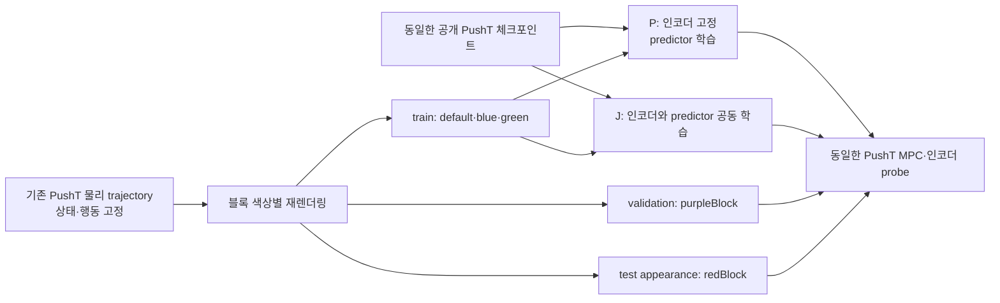

# 현재 진행 중인 PushT 인코더 gradient 실험

이 문서는 `multistep-gradient-ablation` 브랜치의 **P/J 비교 실험**을 설명한다. 목적은 같은 AdaJEPA predictor 손실을 사용할 때, 시각 인코더까지 업데이트하면 색상 변화에 더 강한 표현을 얻는지 확인하는 것이다. 여기서 `multistep`은 평가 시 자동회귀 rollout을 뜻한다. **현재 학습 손실 자체는 자동회귀 다단계 손실이 아니다.**

## 전체 흐름



## 모델과 학습 손실

- 시작 모델: `checkpoints/pusht_visual_shift`의 PushT 체크포인트. 시각 인코더는 `SmallResNetGeM`이며 관측마다 384차원 시각 토큰 하나를 낸다. predictor는 6층 `ViTPredictor`다. DINOv2 기반 인코더를 쓰는 실험이 아니다.
- 시각 입력에 더해 agent 위치·속도에서 만든 proprio 토큰과 행동 임베딩을 predictor에 넣는다. 이 설정의 결합 표현 차원은 404다.
- 한 학습 window에서 관측 프레임 4장은 원본 trajectory의 `s, s+5, s+10, s+15`에 해당한다. `num_hist=3`, `num_pred=1`, `frameskip=5`이며 행동은 길이 5의 블록으로 묶는다.
- predictor의 causal attention은 각 출력 위치가 현재와 이전 입력만 보게 한다. 학습에서는 세 출력 위치가 각각 **바로 다음 관측**을 예측한다. 즉 한 window에 teacher-forced 1-step 예측 세 개가 있다.
- 손실은 예측한 visual·proprio 표현과 다음 관측 표현 사이의 MSE다. target 표현은 `stop_grad=true`로 미분에서 분리된다. 별도 EMA teacher, reconstruction decoder, FiLM, 추가 regularizer는 이 비교에 넣지 않는다.

간단히 쓰면, `z_i`를 `i`번째 관측의 시각·proprio·행동 결합 표현이라 할 때:

```text
예측: [ẑ1, ẑ2, ẑ3] = causal_predictor([z0, z1, z2])
손실: L = MSE([ẑ1, ẑ2, ẑ3]의 visual·proprio 부분,
             stopgrad([z1, z2, z3]의 visual·proprio 부분))
```

계획과 검증에 사용하는 rollout은 이전 예측을 다시 입력하는 자동회귀 방식이다. 그러나 학습 중 세 예측을 하나의 자동회귀 rollout으로 연결하지는 않는다. 따라서 이번 결과를 **새 다단계 학습 손실의 효과**라고 해석하면 안 된다.

## P와 J에서 달라지는 것

| 항목 | P: predictor only | J: joint |
|---|---|---|
| 시각 인코더 파라미터 | 고정 | 학습 |
| 시각 인코더 optimizer | 없음 | Adam, 학습률 `1e-5` |
| predictor | AdamW, 학습률 `5e-4` | 동일 |
| action·proprio 임베딩 | 학습 | 동일 |
| 미래 target branch | `stop_grad` | `stop_grad` |
| 인코더 실행 모드 | eval | eval |
| 학습 데이터·seed·batch·epoch 예산 | 동일 | 동일 |

J에서 인코더가 `eval` 모드인 것은 BatchNorm running statistics와 dropout 동작을 P와 맞추기 위한 것이다. **eval 모드여도 파라미터 gradient는 흐른다.** P는 인코더 파라미터 자체가 고정된다. J에서는 동일한 인코더가 현재 입력과 미래 target을 모두 만들기 때문에, target branch의 gradient는 막혀 있어도 학습이 진행되며 target 표현의 *값*은 변할 수 있다. P/J는 학습 가능한 파라미터 수가 달라 동일한 계산량 비교는 아니다.

## 색상 데이터와 평가 분리

기존 상태·행동 trajectory를 바꾸지 않고 PushT 화면의 블록 색상만 재렌더링한다. 각 window에는 색상 하나를 적용하고, `(episode_index * 1009 + window_start) % 3`으로 학습 색상을 결정한다.

| 용도 | 색상 | RGB |
|---|---|---|
| 학습 | default, blue, green | `(119,136,153)`, `(0,61,153)`, `(0,107,60)` |
| 검증 | purpleBlock | `(160,32,240)` |
| 최종 미관측 색상 평가 | redBlock | `(255,0,0)` |

학습은 `pusht_noise/train`의 물리 trajectory를, 보라색 검증과 빨간색 평가는 `pusht_noise/val`의 물리 trajectory를 사용한다. **보라색과 빨간색은 색상만 서로 독립적으로 holdout되었고 물리 trajectory는 공유한다.** 따라서 빨간색 결과를 독립된 물리 test set 결과라고 주장하지 않는다. `data_audit.json`에는 파일·manifest·물리 trajectory 중복 검사와 색상별 window 수가 기록된다.

## 실행과 체크포인트

- 코드: `conf/env/pusht_gradient.yaml`, `conf/experiment/gradient_p.yaml`, `conf/experiment/gradient_j.yaml`, `train.py`.
- CIRCE 제출: `scripts/slurm_gradient_ablation.bash`에 `P` 또는 `J`를 전달한다. 기본 설정은 seed 0, batch 32, **총 3 epoch**다. 각 실험은 같은 원본 체크포인트에서 시작한다.
- 저장 위치: `gradient_outputs/seed0/models/P`와 `gradient_outputs/seed0/models/J`. 매 epoch가 **완료된 뒤** `checkpoints/model_N.pth`와 `model_latest.pth`를 저장한다.
- Slurm 선점 뒤에는 `RESUME=1`과 기존 `RUN_DIR`로 재제출한다. 완료한 epoch부터 총 3 epoch에 도달할 때까지만 학습한다. 진행 중이던 epoch의 일부 minibatch는 복구하지 않으므로 해당 epoch를 처음부터 다시 계산한다.
- `hydra.yaml`, `provenance.txt`, `optimizer_groups.json`, `epoch_metrics.jsonl`, `resume_history.txt`, Slurm 로그가 설정과 진행 근거다. `optimizer_groups.json`에는 실제 optimizer별 파라미터 수와 window·batch 수를 기록한다.

## 현재 확인된 진행 상황과 다음 평가

2026-11-16에 확인한 저장 파일 기준으로 P에는 `model_2.pth`, J에는 `model_1.pth`가 있다. 원래 작업 `34400580`과 `34400581`은 Slurm 선점으로 종료됐다. 재개 작업 `34404427`(P)은 **epoch 2에서 epoch 3으로 재개하는 사전 검사**를 통과했다. 마지막으로 받은 상태에서 J 재개 작업 `34404429`는 자원 대기 중이었다. 이후 완료 여부와 성능은 아직 확인되지 않았다.

두 모델의 `model_3.pth`가 저장되면 같은 `plan_targets.pkl`의 50개 목표를 default·purpleBlock·redBlock에서 Frozen GD MPC로 평가한다. seed 100, 최대 MPC step 30을 맞춘다. `scripts/slurm_gradient_eval.bash`가 조건별 결과를 남기고 `scripts/aggregate_gradient_mpc.py`가 목표별 성공 여부, 성공률 및 95% Wilson 구간을 집계한다. `scripts/slurm_gradient_probe.bash`는 두 인코더를 고정한 뒤 동일한 선형 상태 probe로 위치·각도 정보, 색상에 따른 latent 변화, 분산·effective rank를 측정한다. 학습 검증에서는 자동회귀 rollout의 horizon 1–5 시각 표현 오차를 별도로 기록한다.

**현재 문서에는 MPC 성공률이나 probe 성능 수치가 없다.** 완성된 체크포인트와 평가 파일을 확인한 후에만 수치를 추가한다. 전체 실행 명령과 원래 코드 경로 감사는 [실험 감사 문서](multistep_gradient_ablation_audit.md)에 있다.
